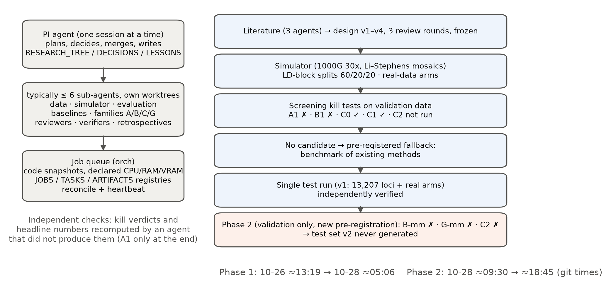
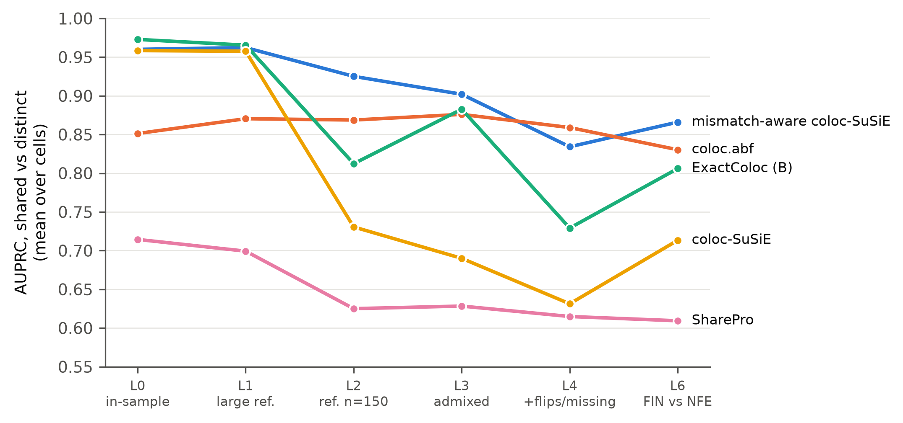
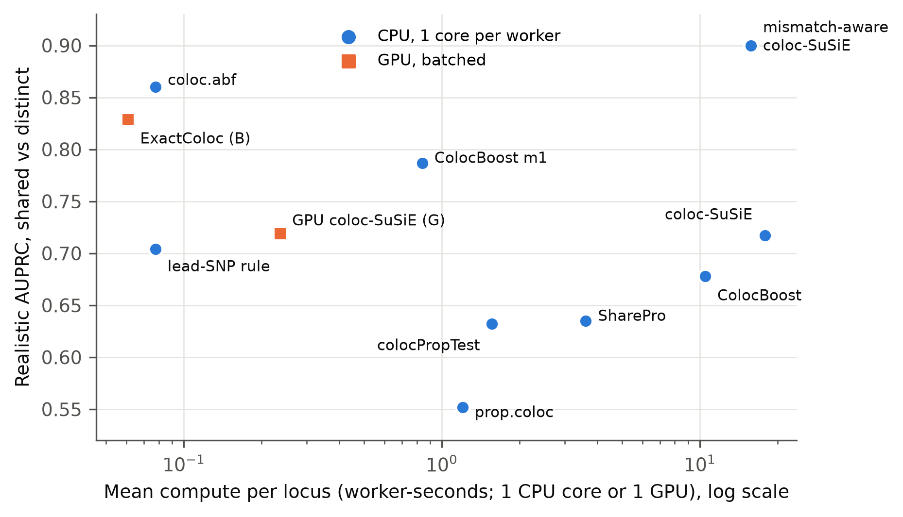
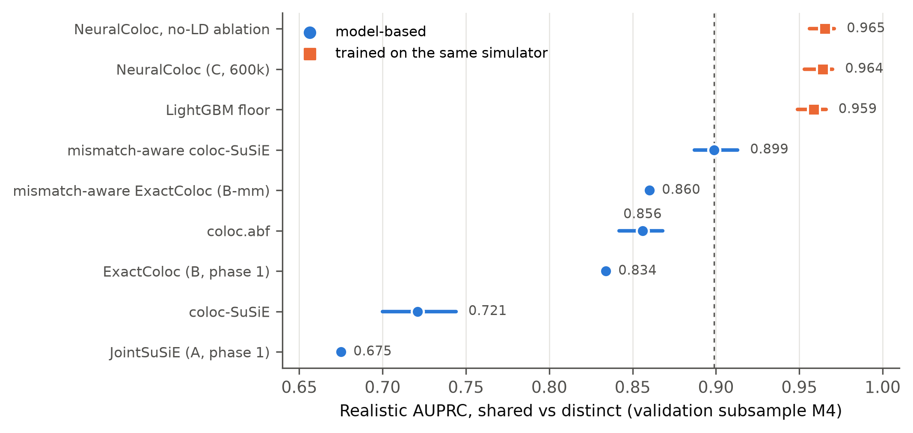

(Human-written text starts)
This is an exercise in assessing the bioinformatics capabilities of agentic AI. It is part of a hackathon run by the Beltrao lab at ETH Zurich, where we used Claude to run bioinformatics projects (https://github.com/evocellnet/ai-hackathon/). All results in this project were generated entirely by AI with minimal human intervention. This is not intended to be viewed as a traditional publication and bioinformatics tool.
The goal of this project was to come up with a new analysis tool to infer colocalization of genomic variants identified by GWAS and QTL studies. It was executed by Claude Opus 5.5 with delegation to Opus 5.5/Sonnet 5.5 subagents, and finished in 50h of wall time on a computational cluster with 64 CPUs with 128 GB RAM and one RTX4090 GPU.
Currently none of the results have been verified by a human. We plan to verify the agent's methodology and benchmarking, and we will update this section accordingly.
The rest of this repository is entirely AI generated. It includes code for implementation of the predictive model and an AI-written report in the style of a journal article, detailing the final method, the path followed to reach it, and benchmarking against other methods.
(Human-written text ends)

---

# LD-reference mismatch, not sample overlap, limits GWAS–QTL colocalization: an agent-run benchmark of existing and new methods

**Short title:** LD mismatch limits GWAS–QTL colocalization

## Abstract

Colocalization analysis tests whether a GWAS signal and a molecular QTL share a causal variant. Standard tools often run with LD from a reference panel, with overlapping study samples, and with signals too weak to separate "distinct" from "no power". An AI agent system was asked to build a faster and more powerful method for these conditions. It pre-registered a simulation benchmark built on 1000 Genomes 30x haplotypes, with six levels of LD-reference mismatch, three sample-overlap designs, three outcome classes (shared, distinct, too weak) and a split by LD block. It screened five new approaches: a joint bivariate SuSiE model, exact Bayesian enumeration on GPU with and without a reference-error likelihood, an amortised neural posterior estimator, and a GPU port of mismatch-aware SuSiE. None passed its pre-registered rules. On a single held-out test of 13,207 simulated loci, the best method was an existing one, coloc-SuSiE with susieR 0.16.6's reference-mismatch model. Its realistic shared-versus-distinct AUPRC was 0.900 (95% CI 0.884–0.914), against 0.860 for coloc.abf and 0.717 for standard coloc-SuSiE. In real GEUVADIS data, its calls changed for 7% of genes when in-sample LD was replaced by a reference panel, against 21% for standard coloc-SuSiE. LD mismatch caused most errors: standard coloc-SuSiE fell from 0.96 with in-sample LD to 0.69–0.73 with a 150-person reference. Sample overlap up to a null correlation of 0.8 barely changed false sharing on weak loci, even for methods that ignore it. Separating distinct from too-weak signals was matched by signal strength alone (AUROC 0.99). GPU implementations gave 1.2–4.8× whole-machine speed-ups, short of the 10× target. We report the agent setup, its decisions and its failures.

## Author summary

Genome-wide association studies find many disease-associated regions. Asking whether the same genetic variant also changes a gene's expression helps to name the gene behind a signal. Methods for this question, called colocalization, often run under conditions their models ignore:
- the correlation between nearby variants (linkage disequilibrium, LD) is borrowed from a small reference panel;
- the studies may share participants;
- one signal may be too weak to say anything.

We tested whether an AI agent system could build a better colocalization method. The agents designed a benchmark in advance and screened five new methods on validation data. Two of them ran as descriptive entries on held-out test data, next to ten existing methods and controls. None of the new methods was better. The most accurate method was an existing option in the susieR package that models reference-panel error. It clearly beat standard coloc-SuSiE and was modestly more accurate than coloc.abf overall, although coloc.abf was better in some settings. Reference-panel mismatch caused most errors; shared participants did not. We also describe where the agent-run research went wrong, and which checks caught it.

## Introduction

Most GWAS loci are non-coding, but estimates of how many colocalize with an expression QTL range from about 20% to 50%, depending on the threshold and the denominator [1–3]. Part of this gap is biological [3,4]. Part is statistical:
- **Power.** Colocalization posteriors confuse "no shared variant" with "not enough power" [5–7].
- **LD mismatch.** Summary-statistic fine-mapping is sensitive to the LD matrix. With out-of-sample references, credible-set coverage drops, and a single allele flip can produce a confident false credible set [8]. Meta-analysis fine-mapping is often miscalibrated [9].
- **Sample overlap.** It correlates the two studies' noise; under the null, z-scores correlate with ρ = N_s·r_p/√(N₁N₂) [10].

Existing methods address parts of this:
- coloc.abf assumes at most one causal variant per trait and uses no LD [11];
- coloc-SuSiE fine-maps each trait first, then pairs the credible sets [12,13];
- susieR 0.16.x added an option that models finite-reference LD error (`R_finite`, `R_mismatch = "eb_mix"`). It is documented in a vignette; we found no peer-reviewed description [14];
- SharePro [15], ColocBoost [16] and mvSuSiE [17] fine-map the two traits jointly;
- proportional tests take colocalization (proportional effects) as their null, so "distinct" is what they can detect [18,19];
- gpu-coloc made the pairing step fast [20].

We found no study that measured colocalization error as a function of both LD-reference mismatch and sample overlap.

This project was an exercise in agentic research (see the disclosure; Fig 1). An AI agent acting as principal investigator (PI) received a brief (S1 File):
- optimize GWAS–QTL colocalization for speed and power;
- cope with sample overlap and mismatched LD;
- separate two distinct causal variants from a too-weak signal;
- keep at least three model families alive through screening.

The agent system pre-registered a benchmark, screened new approaches and ran one held-out test. After a human "Go", it ran a second pre-registered phase on validation data. This paper reports what was built, what failed and why, and what the benchmark shows about existing methods.

**Fig 1. Agent setup and project flow.** Left: the PI agent, sub-agents in separate worktrees, and the job queue with its registries. Right: the research path. Kill verdicts and headline numbers were recomputed by an agent that had not produced them; the A1 verdict was recomputed only at the end of the project. Times are git commit times.

## Results

### A pre-registered benchmark with three outcome classes

Each simulated locus pairs a GWAS-like trait with a molecular trait. Simulation truth assigns each locus to one class (Methods):
- **S:** a causal variant shared and powered in both traits;
- **D:** distinct causal variants, each powered in its own trait;
- **W:** at least one trait with no causal variant above 20% power;
- **G and U:** grey and unidentifiable cases, excluded from the endpoints.

There are two co-primary endpoints:
1. AUPRC for S versus D, after power matching. S and D are reweighted to the same distribution of signal strength, so a method cannot win by detecting strong signals.
2. AUROC of P_D on D ∪ W.

"Realistic" results pool the 27 cells with mismatched LD (L1–L6, crossed with overlap designs); "ideal" means in-sample LD (L0). Data were split by LD block (60/20/20), and the test split was used once. The design went through three review rounds before it was frozen. It fixed kill rules for each new approach in advance, and a fallback deliverable if none survived: a benchmark of existing methods.

### No new approach passed screening

Screening used validation data only (Table 1; details in S1 Text). Kill verdicts and the numbers they rest on were recomputed by an agent that had not produced them. The exceptions are listed in Methods.

**Table 1. Screening outcomes on validation data.**

| Approach | Idea (credit) | Decisive test | Result | Verdict |
|---|---|---|---|---|
| A: JointSuSiE | Bivariate SuSiE-RSS with per-effect sharing states, overlap-whitened noise and LD regularisation [8,12,17] | A1: AUPRC at L0, ρ = 0, vs the best baseline | 0.893 vs coloc-SuSiE 0.978 (Δ −0.085 [−0.105, −0.064]) | Killed |
| B: ExactColoc | Exact enumeration of ≤ 2 causal variants per trait; support-space Bayes factor with overlap [11,21] | Rule (c): false-S at L4 / ρ = 0.5 at the matched-W threshold | 0.21 / 0.16 vs 0.05 / 0.06 | Killed |
| C: NeuralColoc | Amortised neural posterior estimation [22]; transformer with an LD attention bias [23] | C0 and C1 passed; C2 not run in phase 1 | C1 E[KL] 0.0056 (bar 0.02) | Unfinished in phase 1 |
| B-mm (phase 2) | B plus a likelihood for reference-panel error in the LD matrix [8] | Candidacy bar: validation AUPRC ≥ mismatch-aware coloc-SuSiE − 1 SE | 0.860 vs 0.899 (Δ −0.039 ± 0.009) | Killed |
| G-mm (phase 2) | GPU port of the susieR 0.16.6 mismatch model with coloc pairing [14,20] | Identity with R; whole-machine throughput ≥ 5× | 4 non-converged fits fail the frozen 10⁻³ bar (1 even under a post-hoc amended rule); 4.77× | Failed (report-only) |
| C (phase 2) | C trained on 600,000 records | C2: beat its own no-LD ablation by > 1 SE | −0.001 ± 0.002 | Failed |

Two results matter beyond the verdicts.

**A one-sided threshold rule can kill the wrong method.** The pre-registered rule set t_S to the smallest threshold that keeps confident-S calls on W loci at or below 2.5%. ExactColoc puts almost no P_S on weak loci, so the rule set its threshold at 0.013. At that threshold it called 22% of distinct loci shared. At a fixed 0.8, the same method had the lowest false-S rate of all methods. The rule limits only one direction of error. Phase 2 added a two-sided operating point, but this did not rescue the ExactColoc line (Table 1).

**In-simulator learning is not evidence of a better method.** Phase 2 trained NeuralColoc on 600,000 simulated records. On the validation subsample it reached AUPRC 0.964. So did two simpler models:
- its no-LD ablation, 0.965;
- a LightGBM classifier [24] on coloc and SuSiE summaries, 0.959.

The best model-based method reached 0.899 (Fig 4). The verifier found no train/validation leakage: no shared LD blocks or windows, and metadata features alone scored at chance. But all three learned models were trained and validated on the same simulator, priors and class definitions. Their tie with the no-LD model suggests that they learned the simulator's prior, not LD. We therefore do not read 0.96 as evidence that NeuralColoc would beat model-based methods on real data.

### Mismatch-aware coloc-SuSiE was the most accurate method on the held-out test

With no candidate, the test run benchmarked existing methods, with B and G as pre-declared descriptive entries (Table 2).
- **Test set.** 13,207 simulated loci from the test LD blocks: S 3,513, D 3,514, W 4,555, G 1,236 and U 389.
- **One run** (nonce ab94c5a1). It was interrupted once, to drop mvSuSiE under a pre-declared overrun rule, and then resumed with the same code.
- **Verification.** An independent agent reproduced every headline number to within 5×10⁻¹⁴ with its own code.

**Table 2. Test-set results.** Single run, failures scored least-favourably, 95% BCa CIs over LD blocks. Bold marks the best non-control method in each column.

| Method | AUPRC S-vs-D, realistic | AUPRC, ideal (L0) | AUROC D-vs-W, realistic | Mean CPU-s or GPU-s per locus |
|---|---|---|---|---|
| coloc-SuSiE, mismatch-aware (susieR 0.16.6) | **0.900 [0.884, 0.914]** | 0.962 | 0.906 | 15.8 |
| coloc.abf (W = 0.2) | 0.860 [0.846, 0.874] | 0.856 | **0.957** | 0.078 |
| ExactColoc (B, descriptive) | 0.829 [0.808, 0.849] | **0.969** | 0.949 | **0.061 (GPU)** |
| coloc-SuSiE (susieR 0.14.2) | 0.717 [0.697, 0.741] | 0.966 | 0.815 | 17.9 |
| GPU coloc-SuSiE (G, descriptive) | 0.719 [0.700, 0.744] | 0.966 | 0.816 | 0.236 (GPU) |
| Lead-SNP rule | 0.704 [0.675, 0.731] | 0.699 | — | 0.078 |
| SharePro | 0.635 [0.607, 0.658] | 0.716 | 0.386 | 3.6 |
| colocPropTest | 0.632 [0.610, 0.651] | 0.635 | — | 1.6 |
| prop.coloc | 0.552 [0.529, 0.577] | 0.682 | — | 1.2 |
| Strength-only control | 0.519 [0.503, 0.537] | 0.471 | 0.992 | 0.09 |
| ColocBoost, mode 1 (subsample, n = 4,467) | 0.787 [0.756, 0.827] | 0.827 | 0.938 | 0.84 |
| ColocBoost (subsample) | 0.678 [0.625, 0.715] | 0.838 | 0.741 | 10.5 |

On the ColocBoost subsample, coloc.abf scored 0.881 and mismatch-aware coloc-SuSiE 0.914. mvSuSiE was not run on the test set.

**Against standard coloc-SuSiE,** mismatch-aware coloc-SuSiE matched it with in-sample LD (0.962 vs 0.966) and beat it under mismatch. The cost was similar, and it had no failures (standard coloc-SuSiE had 31).

**Against coloc.abf,** it was 0.04 higher in realistic AUPRC, with non-overlapping CIs. This comparison is descriptive, not a pre-registered paired test. coloc.abf was better in three respects, and much cheaper:
- at L4, where the reference also has allele flips and missing variants (0.859 vs 0.834);
- on D-vs-W AUROC;
- on false-S among distinct loci at the frozen thresholds (6.7% vs 9.5%).

### LD mismatch, not sample overlap, drove the errors

S-vs-D AUPRC by mismatch level is shown in Fig 2.
- **Standard coloc-SuSiE** dropped from 0.96 at L0 to:
  - 0.73 with a 150-person reference (L2);
  - 0.69 with an admixed QTL study (L3);
  - 0.71 with a Finnish GWAS against a non-Finnish QTL (L6).

  At L4 it scored 0.63, but its failure rate exceeded the pre-registered 1% limit in some L4 cells, so claims there are blocked.
- **A large, well-matched reference** (L1, n = 2,000) cost nothing.
- **Mismatch-aware coloc-SuSiE** scored between 0.83 and 0.93 at L2–L6 (0.96 at L1).
- **coloc.abf** stayed between 0.83 and 0.88 at every level, because it uses no LD. Its errors are those of the single-variant model: false-S was 26% for D pairs with r² 0.8–0.95, and 36% for barely identifiable pairs.

**Fig 2. S-vs-D AUPRC by LD-mismatch level on the test set.** Each point is the unweighted mean of per-cell AUPRC within a level: seven overlap cells for L0, L1, L2 and L4, and three cells (all ρ = 0) for L3 and L6. L0, in-sample LD; L1, large matched reference; L2, 150-person reference; L3, admixed QTL study; L4, L2 plus allele flips and missing variants; L6, Finnish GWAS against a non-Finnish QTL. The L4 values of standard coloc-SuSiE and SharePro are claim-blocked (> 1% failures in at least one cell).

Sample overlap changed little. In the P2 and P3 cells, the slope of false-S on weak loci per 0.1 of realised ρ stayed within ±0.02 for every method, the pre-registered no-effect margin. This held even for coloc.abf and both coloc-SuSiE variants, which do not model overlap at all. On distinct loci, some slopes reached −0.02, meaning false sharing decreased as ρ increased. We did not run methods with and without ρ̂, so we cannot say whether supplying it is necessary.

### Distinct-versus-weak separation is solved by signal strength

On D ∪ W, the strength-only control reached AUROC 0.992, and no method beat it (best: coloc.abf, 0.957). W loci are weak by construction, so this endpoint mostly measures signal strength. The scientifically hard contrast is S versus D. There, after power matching, the same control scored 0.519, close to chance.

### Real data agree with the simulation ranking

Three real-data arms were built on the test split (Methods; Table 3):
- **R2:** the same gene and tissue in two non-overlapping eQTL Catalogue cohorts, used as partial positives;
- **R3b:** FinnGen × eQTL pairs with disjoint, unlinked credible sets, used as pseudo-negatives;
- **R4b:** GEUVADIS genes, run with exact in-sample LD and with a reference panel.

**Table 3. Real-data arms** (test split; cluster-bootstrap 95% CIs).

| Method | R2 S recall at 5% confident-S on R3b | R4b call agreement, in-sample vs reference LD |
|---|---|---|
| coloc-SuSiE, mismatch-aware | 0.918 [0.897, 0.941] | 0.927 [0.905, 0.946] |
| coloc.abf | 0.913 [0.893, 0.936] | 1.000 (uses no LD) |
| coloc-SuSiE | 0.853 [0.818, 0.887] | 0.793 [0.755, 0.827] |
| SharePro | 0.830 [0.000, 0.934] | 0.847 [0.809, 0.886] |
| Strength-only control | 0.134 [0.113, 0.343] | 1.000 (uses no LD) |

Swapping in-sample LD for a reference changed standard coloc-SuSiE's three-way call for 21% of genes, against 7% for the mismatch-aware version. On R2/R3b, mismatch-aware coloc-SuSiE and coloc.abf were equal within error. These arms test relative behaviour only: R2 contains some truly distinct pairs, and R3b may contain undetected sharing.

### GPU engines kept accuracy but gave modest whole-machine gains

Fig 3 plots accuracy against compute per locus. Per worker (one GPU against one CPU core), ExactColoc was 294× and GPU coloc-SuSiE 76× cheaper than standard coloc-SuSiE. The pre-registered measure is whole-machine throughput against all 64 cores, and on that measure the gains were small:
- ExactColoc about 4.6×;
- GPU coloc-SuSiE about 1.2×;
- G-mm, the phase-2 GPU port of mismatch-aware coloc-SuSiE, 4.77× under an exclusive timing protocol (31,838 vs 6,670 loci per hour).

None reached the 10× target. Serial reading of loci from disk took about 60% of G-mm's time.

**Fig 3. Accuracy against compute on the test set.** Realistic S-vs-D AUPRC against mean compute per locus, on a log scale. Squares mark GPU methods, timed per GPU; circles mark CPU methods, timed per core. Whole-machine ratios are much smaller than per-worker ratios (see text). ColocBoost values come from its subsample of 4,467 loci; on that subsample, coloc.abf scored 0.881 and mismatch-aware coloc-SuSiE 0.914.

### Validated operating thresholds for mismatch-aware coloc-SuSiE

Phase 1 had only screen-set thresholds for mismatch-aware coloc-SuSiE, so phase 2 fitted them on the validation subsample. Its AUPRC there was 0.899 (0.887–0.913), confirmed independently. The pre-registered rule allows at most 2.5% confident-S and at most 2.5% confident-D calls on W. Under it, the thresholds are:
- **call shared** if PP.H4 ≥ 0.840;
- **call distinct** if the distinct score is ≥ 0.732.

At these thresholds, 78% of S loci and 80% of D loci are called correctly on validation, and 9.7% of power-matched D loci are called shared. These thresholds have not been applied to test data. On the test set, the earlier screen-set thresholds gave 3.6% confident-S calls on W loci.

**Fig 4. Phase-2 validation results.** Realistic S-vs-D AUPRC on the validation subsample (M4, 12,170 loci). JointSuSiE was run on the realistic cells only (9,677 loci). Squares mark methods trained on the same simulator; their scores measure transfer across genomic regions, not across data-generating models. Horizontal bars are 95% CIs, where they were computed. The dashed line marks mismatch-aware coloc-SuSiE.

## Discussion

The project did not produce a new method that beats existing ones under realistic conditions. It produced four useful things:
1. a benchmark of existing methods under LD mismatch and sample overlap;
2. evidence that a little-used option in susieR, finite-reference LD modelling, matters more than the choice between coloc.abf and coloc-SuSiE;
3. validated calling thresholds for that option;
4. a record of how an agent system carried out, and failed at, method development.

**Recommendations.**
- Use mismatch-aware coloc-SuSiE when LD comes from a reference panel and about 16 CPU-seconds per locus is affordable.
- Use coloc.abf when speed matters, or when the reference may have allele-coding problems (L4).
- Do not treat D-vs-W separation as evidence of method quality, since signal strength alone achieves it.
- In our simulation, sample overlap up to ρ = 0.8 was not a material source of false sharing, even for methods that ignore it.

**Why the new approaches failed.**
- **The joint model (A)** lost about 0.085 AUPRC to coloc-SuSiE even with exact LD. We did not find out whether the sharing states or the LD regulariser were responsible.
- **ExactColoc** was accurate with exact LD and fast, but brittle under mismatch. Adding a reference-size likelihood helped (+0.040 AUPRC on mismatched loci), but not enough.
- **The learned methods** fit the simulator rather than LD. A fair test needs data from a different generator, or real labels.
- **The GPU ports** were limited by data loading and kernel latency rather than arithmetic.

**Limitations.**
- The simulation used one population-genetic backbone: 1000G 30x with Li–Stephens mosaics. The real-data arms test relative behaviour only.
- Test-set CIs rest on 53 LD-block clusters, against about 267 planned, so they are wider than designed. Per-cell results (100 loci per class) are descriptive.
- ρ̂ was estimated within cis windows, where it absorbs shared signal: about 0.1 for donor-disjoint eQTL pairs. This could penalise overlap-aware methods on real eQTL × eQTL data.
- Mismatch-aware coloc-SuSiE's three-way calls on the test set used screen-set thresholds; the validated thresholds came later.
- Runtimes came from a shared node, except the exclusive G-mm timing.
- Phase 2 was chosen after seeing phase-1 test results, and some of its choices were made after the fact: the 10% bound on false-S among distinct loci, two G-mm identity rules, a test tolerance and a CUDA stream count. All are disclosed. None changes a verdict: B-mm's candidacy miss and C's C2 failure do not depend on thresholds, and G-mm fails even the amended rule.

**On agent-run research.** The process record (S2 Text; the record files at the repository root, `docs/` and `reviews/`) shows strengths and failures.

Strengths:
- Pre-registration, kill rules and a fallback deliverable prevented any rescue of failing methods.
- Reviewers who recomputed results, rather than only reading them, found errors before use, among them:
  - a Kronecker-order error;
  - wrong generator scaling;
  - a bias in ρ̂;
  - an unreachable overlap grid;
  - wrong P_S/P_D formulas;
  - a test-access bug that would have aborted the test run.
- An independent verifier corrected a timing repeat count after the result was already in a report.

Failures:
- About 21% of the 22-hour phase-1 budget ran without active supervision.
- Two PI sessions once ran at the same time and broke shared code.
- GPU contention delayed phase-2 work by hours.
- One rule was set after its result but labelled as pre-registered, and decision times were written from memory. Both were corrected after review.
- The PI agent's summaries overstated results:
  - per-worker speed-ups were headlined as gains (caught by the final retrospective agent);
  - a failed method's in-simulator score was called "promising" (the human objected).

  See lessons 25, 27 and 33 in S2 Text.

## Methods

### Agent setup

The project ran in Claude Code on one cluster node with 64 CPU cores, 128 GB RAM and one RTX 4090 (Fig 1).
- **PI.** One agent at a time acted as PI (Claude Opus 5.5), across several successive sessions. The PI planned work, wrote decision notes and merged code. Once, two PI sessions overlapped by accident.
- **Sub-agents** were spawned for each task, typically up to six at a time. During the duplicate-PI incident there were briefly ten. Project policy assigned Opus 5.5 to reasoning tasks and Sonnet 5.5 to mechanical ones; which model each agent actually used was not logged. The roles were:
  - literature and design reviewers;
  - data, simulation, evaluation and baseline engineers;
  - method-family developers;
  - independent verifiers;
  - retrospective reviewers.
- **Worktrees and reports.** Each sub-agent worked in its own git worktree. It ended with a fixed report footer: branch, artifacts, jobs, tests, and the decisions needed, each with a recommended default.
- **Job queue (`orch`).** All compute went through a small job queue:
  - it snapshots the committed code;
  - it schedules declared CPU, RAM and GPU memory;
  - it keeps registries of jobs, tasks and artifacts.

  A reconcile script flagged failed jobs, orphan processes and checksum mismatches. The PI looped on a 12-minute heartbeat with an hourly status refresh.
- **Records.**
  - **Research tree:** every decision (D0–D29), plus detailed decisions P3-1–P3-30 and P4-1–P4-8.
  - **Lessons file:** 33 process rules, each with the incident behind it.
  - **Retrospectives:** written by fresh agents at milestones.
- **Verification.** Every kill verdict and every headline number was recomputed by an agent that had not produced it, where possible with its own code. The exceptions:
  - A1 was recomputed only at the end of the project;
  - C0, the 74,000-record LightGBM floor comparison and B-mm's rules (a), (b) and (d) were not recomputed;
  - for C1, the verifier checked the scoring fix on a 600-locus pilot, not the final value.

**Human input.** The human (in quotes, the human's words):
- gave the initial brief and a restart brief with operating rules (S1 File);
- said "do not spend considerable effort trying to access datasets";
- told the agents not to write to the home directory;
- set time budgets and announced session-limit pauses;
- noted that the research tree did not show running jobs and that the 12-minute check-ins had stopped;
- issued resume commands ("pick it up again", "resume", "remount");
- approved ending a duplicate, headless PI session;
- asked which unfinished directions looked promising, then said "Go";
- asked for a comparison against mismatch-aware coloc-SuSiE;
- objected to unclear summaries and to moving goalposts;
- asked for this paper.

The human did not write code or edit results. The agents chose the methods.

**Wall time and compute.** The project took about 53.4 hours from the first commit (10-26 13:19) to the phase-2 closing commit (10-28 18:45). That includes about 4.4 hours idle between the phases, so about 49 hours of active work. The job queue ran 318 jobs, reserving about 1,200 core-hours, in addition to interactive work. The project began without the queue: five agents sharing one GPU caused out-of-memory deaths and an unnoticed overnight stall. That stall led to the restart with the queue.

### Data

- **Genotypes.** The 1000 Genomes 30x phased GRCh38 panel [25]: biallelic SNVs with MAF ≥ 0.01, MHC excluded. Four pools:
  - 254 NFE individuals (target);
  - 150 NFE individuals (external reference);
  - 99 FIN;
  - 157 ASW/ACB.
- **Maps and annotation.**
  - Beagle GRCh38 genetic maps;
  - GRCh38 EUR LD blocks [26], tiled to cover each chromosome;
  - GENCODE v39.
- **Real data.**
  - eQTL Catalogue r7 [27]: nine datasets, CC BY 4.0;
  - FinnGen R12 summary statistics and SuSiE results [28], used under FinnGen terms; only derived results are distributed;
  - GEUVADIS [29], through the eQTL Catalogue.

All builds are hg38. Checksums and licences are listed in DATA.md.

### Splits

The 1,358 tiled LD blocks were assigned to train, validation and test (60/20/20) by a seeded draw, stratified by chromosome. Each gene takes the split of the block that contains its TSS. Windows (±500 kb) are clipped to runs of same-split blocks, so every variant belongs to one split. The test split was read once, inside a locked pipeline. Its access log records "started", "interrupted", "resumed" and "completed".

### Simulation

- **Population.** A Li–Stephens mosaic [30] of the target haplotypes (N = 20,000).
- **Traits.**
  - Small-N traits (N ≤ 20,000) are simulated at the individual level: each study draws its own sample, and the z-scores are OLS statistics, so they carry in-sample LD noise.
  - Large-N traits use the factor form z = Rλ + e.
- **Overlap.** Generated at the realised null correlation ρ = N_s·r_p/√(N₁N₂). Methods receive ρ̂, never the true ρ. ρ̂ comes from a truncated bivariate-normal maximum-likelihood fit on null SNPs.
- **Mismatch levels.**
  - **L0:** in-sample LD;
  - **L1:** an independent mosaic reference (n = 2,000);
  - **L2:** 150 real reference individuals;
  - **L3:** an admixed QTL study (15% ASW/ACB);
  - **L4:** L2 plus 0.5% allele flips and 5% missing variants;
  - **L6:** a Finnish-like GWAS against a non-Finnish QTL study.
- **Pairing designs**, with headline weights:
  - **P1** (0.5): eQTL × GWAS;
  - **P2** (0.25): a large-N molecular trait against a biobank GWAS, ρ up to 0.3;
  - **P3** (0.25): full overlap, ρ up to 0.8.
- **Architectures.** Loci are drawn from a mixture of shared, distinct, weak and multi-causal architectures, with per-variant variance explained drawn log-uniformly. Evaluation cells are filled by rejection sampling on the oracle class.
- **Shifted arm.** A test-only arm swaps the target and reference haplotype pools and changes the class mix and architectures.

### Classes and endpoints

- **Powered.** A causal variant counts as powered in a trait if its realised noncentrality |μ| reaches the threshold for 80% power: 6.29 for GWAS-like traits (α = 5×10⁻⁸) and 5.26 for molecular traits (α = 10⁻⁵).
- **Weak.** Below 20% power: |μ| < 4.61 and |μ| < 3.58 respectively.
- **Classes**, in order of precedence: S, then U (distinct but d = min|λ|·√(1−r²) < 2), then D, then W, then G.
- **Method outputs.** Pre-registered adapters map each method to an ungated S-vs-D score s, P_S and an ungated P_D.
- **Power matching.** Within each cell, S and D are reweighted to the same (μ₁, μ₂) distribution in 5 × 5 quantile bins, giving a weighted S prevalence of 0.5.
- **Failures.** A crash, timeout or missing output is scored least-favourably: s = 0 for S and s = 1 for D. More than 1% failures in a cell blocks claims there.
- **Uncertainty.** CIs are BCa intervals from 2,000 paired cluster-bootstrap replicates over test LD blocks.
- **Three-way calls** use thresholds fitted on validation by the matched-W rule (OP1). Calls at a fixed 0.8 are also reported.

### Methods compared

- **coloc.abf:** coloc 5.2.3 [11], with W tuned on validation to 0.2 and p12 = 5×10⁻⁶.
- **coloc-SuSiE:** susieR 0.14.2 `susie_rss` with L = 10, then `coloc.bf_bf` [12,13].
- **Mismatch-aware coloc-SuSiE:** susieR 0.16.6 `susie_rss` with `R_finite = n_ref` and `R_mismatch = "eb_mix"` [14], then `coloc.bf_bf`.
- **Others:**
  - SharePro [15];
  - ColocBoost, default and mode 1 [16];
  - mvSuSiE-RSS [17], validation only;
  - colocPropTest [18];
  - prop.coloc [19];
  - a lead-SNP rule;
  - a strength-only control that scores loci by signal strength alone.

Each wrapper was checked against its package's documented example. These checks caught two problems before the benchmark ran:
- known-direction controls found inputs that were not OLS z/se, which made prop.coloc reject sharing on 70% of shared loci;
- failure diagnosis showed that prop.coloc's errors came from exactly singular LD sub-matrices in the n = 150 reference. This is a method limitation and was not tuned away.

### New approaches

Each approach is summarised here; S1 Text gives the equations and full results.
- **A (JointSuSiE)** extends SuSiE-RSS [8,12] to two traits.
  - Each single effect has a variant and a state: null, trait 1 only, trait 2 only, or both.
  - The noise covariance V ⊗ R̃ includes ρ̂.
  - An LD regulariser η is estimated inside the IBSS iterations.
  - P_S and P_D come from inclusion–exclusion over per-effect event probabilities.
- **B (ExactColoc)** enumerates every configuration of at most two causal variants per trait on a screened set of M = 50 variants. Each configuration gets an exact Gaussian Bayes factor in the space of its active effects, with overlap entering through V. This is the Bayes-factor approach of coloc [11], applied to the RSS likelihood [21]. Loci are processed in GPU batches.
- **B-mm** adds a variance term for finite reference size, Var((R̂b)_k) ≈ Σ_j b_j²(1 − r_jk²)²/n_ref, plus cross terms. It was derived in the project as a delta-method approximation for sample correlations, motivated by the LD-mismatch analysis in [8]. It plugs in the posterior second moments of b, so the Bayes factor stays exact for that covariance.
- **C (NeuralColoc)** is an amortised posterior estimator [22].
  - A transformer over the screened variants [23], with an attention bias learned from LD, feeds a readout structured like a Bayes factor.
  - It is exactly invariant to allele flips.
  - It was trained on train-split simulations, with the L6 and L6c mechanisms held out.
- **G and G-mm** are batched GPU ports, for speed only. G ports susieR 0.14.2 and G-mm ports susieR 0.16.6's mismatch model, both with coloc pairing.

### Screening rules and phase 2

The kill rules (S1 Text) compared each approach with the best baseline on four things:
- AUPRC at L0;
- confident calls on W;
- false-S at L4 and at ρ = 0.5;
- runtime.

Phase 2 was pre-registered after one review round. It added three things:
- a two-sided operating point: at most 2.5% confident-S on W and at most 10% on distinct loci (the 10% was chosen after phase 1, and this is disclosed);
- a candidacy bar against mismatch-aware coloc-SuSiE;
- a fresh test set (v2), to be used only if a candidate survived.

No candidate survived, so v2 was never generated.

### Real-data arms

- **R2:** 800 gene–tissue pairs measured in two non-overlapping eQTL Catalogue cohorts.
- **R3b:** 1,237 FinnGen × eQTL pairs. Each trait has exactly one credible set; the sets are disjoint, with lead r² < 0.1.
- **R4b:** 600 GEUVADIS genes. In-sample LD comes from the 1000G genotypes of the same individuals, and the reference excludes them.

The pre-registered metrics are:
- R2 recall at the threshold that gives 5% confident-S on R3b;
- R4b agreement of three-way calls.

### Runtime

Per-locus runtimes include reading the LD matrix. Whole-machine throughput for G-mm was measured on a fixed slice of 2,000 validation loci under an exclusive lock, with three repeats. The CPU baselines in that measurement used 40 memory-limited workers.

## Data availability

All code (`src/`, `scripts/`), the minimal usable method (`mvp/`), all method predictions on the test set and the truth tables for the simulated loci (`results/`), the original prompts (`PROMPT.md`, `docs/prompts/`) and the full agent process record (repository root, `docs/`, `reviews/`) are in the accompanying repository (coloc-agentic-benchmark). It includes:
- a script that recomputes every test-set number from the shipped predictions;
- a pipeline script that runs mismatch-aware coloc-SuSiE with the validated thresholds.

Raw data are not redistributed:
- 1000 Genomes 30x (IGSR, open access);
- eQTL Catalogue r7 (CC BY 4.0, EMBL-EBI);
- FinnGen R12 summary statistics (FinnGen public release; terms forbid redistribution).

Download scripts with checksums are included.

## Acknowledgments

We want to acknowledge the participants and investigators of the FinnGen study. We thank the eQTL Catalogue, the 1000 Genomes Project and the GEUVADIS consortium for open data. 

## Supporting information

- **S1 Text. Approaches that did not work.** Models, equations, kill tests and diagnoses for A, B, B-mm, C, G and G-mm.
- **S2 Text. Agent process record.** Timeline, incidents and the rules they produced, with pointers to the decision log, lessons, retrospectives and independent verifications (repository root, `docs/` and `reviews/`).
- **S1 File. Original and restart prompts, verbatim.**

## References

1. Aguet F, Anand S, Ardlie KG, Gabriel S, Getz GA, Graubert A, et al. The GTEx Consortium atlas of genetic regulatory effects across human tissues. Science. 2020;369(6509):1318–1330. doi:10.1126/science.aaz1776
2. Mountjoy E, Schmidt EM, Carmona M, Schwartzentruber J, Peat G, Miranda A, et al. An open approach to systematically prioritize causal variants and genes at all published human GWAS trait-associated loci. Nat Genet. 2021;53(11):1527–1533. doi:10.1038/s41588-021-00945-5
3. Mostafavi H, Spence JP, Naqvi S, Pritchard JK. Systematic differences in discovery of genetic effects on gene expression and complex traits. Nat Genet. 2023;55(11):1866–1875. doi:10.1038/s41588-023-01529-1
4. Connally NJ, Nazeen S, Lee D, Shi H, Stamatoyannopoulos J, Chun S, et al. The missing link between genetic association and regulatory function. eLife. 2022;11:e74970. doi:10.7554/eLife.74970
5. Hukku A, Pividori M, Luca F, Pique-Regi R, Im HK, Wen X. Probabilistic colocalization of genetic variants from complex and molecular traits: promise and limitations. Am J Hum Genet. 2021;108(1):25–35. doi:10.1016/j.ajhg.2020.11.012
6. Rosen JD, Broadaway KA, Brotman SM, Mohlke KL, Love MI. Higher eQTL power reveals signals that boost GWAS colocalization. Am J Hum Genet. 2026;113(4):868–876. doi:10.1016/j.ajhg.2026.02.009
7. Wallace C. Eliciting priors and relaxing the single causal variant assumption in colocalisation analyses. PLoS Genet. 2020;16(4):e1008720. doi:10.1371/journal.pgen.1008720
8. Zou Y, Carbonetto P, Wang G, Stephens M. Fine-mapping from summary data with the "Sum of Single Effects" model. PLoS Genet. 2022;18(7):e1010299. doi:10.1371/journal.pgen.1010299
9. Kanai M, Elzur R, Zhou W, Wu KHH, Rasheed H, Tsuo K, et al. Meta-analysis fine-mapping is often miscalibrated at single-variant resolution. Cell Genom. 2022;2(12):100210. doi:10.1016/j.xgen.2022.100210
10. Bulik-Sullivan B, Finucane HK, Anttila V, Gusev A, Day FR, Loh PR, et al. An atlas of genetic correlations across human diseases and traits. Nat Genet. 2015;47(11):1236–1241. doi:10.1038/ng.3406
11. Giambartolomei C, Vukcevic D, Schadt EE, Franke L, Hingorani AD, Wallace C, et al. Bayesian test for colocalisation between pairs of genetic association studies using summary statistics. PLoS Genet. 2014;10(5):e1004383. doi:10.1371/journal.pgen.1004383
12. Wang G, Sarkar A, Carbonetto P, Stephens M. A simple new approach to variable selection in regression, with application to genetic fine mapping. J R Stat Soc Series B Stat Methodol. 2020;82(5):1273–1300. doi:10.1111/rssb.12388
13. Wallace C. A more accurate method for colocalisation analysis allowing for multiple causal variants. PLoS Genet. 2021;17(9):e1009440. doi:10.1371/journal.pgen.1009440
14. Stephens Lab. Modeling and accounting for LD reference mismatch [susieR vignette; R_finite, R_mismatch]. susieR 0.16.x [cited 2026 Oct 26]. Available from: https://stephenslab.r-universe.dev/susieR/doc/rss_mismatch.html
15. Zhang W, Lu T, Sladek R, Li Y, Najafabadi H, Dupuis J. SharePro: an accurate and efficient genetic colocalization method accounting for multiple causal signals. Bioinformatics. 2024;40(5):btae295. doi:10.1093/bioinformatics/btae295
16. Cao X, Sun H, Feng R, Mazumder R, Najar CFBA, Li YI, et al. Integrative multi-omics QTL colocalization maps regulatory architecture in aging human brain. medRxiv [Preprint]. 2025. doi:10.1101/2025.04.17.25326042
17. Zou Y, Carbonetto P, Xie D, Wang G, Stephens M. Fast and flexible joint fine-mapping of multiple traits via the Sum of Single Effects model. Nat Genet. 2026;58(2):454–462. doi:10.1038/s41588-025-02486-7
18. Wallace C, Robins C, Johnson T. Variable information across SNPs in GWAS data can cause false rejections of colocalisation which can be resolved by proportional colocalisation tests. bioRxiv [Preprint]. 2025. doi:10.1101/2025.09.08.674910
19. Patel A, Whittaker JC, Burgess S. A frequentist test of proportional colocalization after selecting relevant genetic variants. Hum Hered. 2026 [Online ahead of print]. doi:10.1159/000553247
20. Jesse M, Riet AE, Alasoo K. Ultra-fast genetic colocalisation across millions of association signals. PLoS Genet. 2026;22(6):e1012209. doi:10.1371/journal.pgen.1012209
21. Zhu X, Stephens M. Bayesian large-scale multiple regression with summary statistics from genome-wide association studies. Ann Appl Stat. 2017;11(3):1561–1592. doi:10.1214/17-AOAS1046
22. Cranmer K, Brehmer J, Louppe G. The frontier of simulation-based inference. Proc Natl Acad Sci U S A. 2020;117(48):30055–30062. doi:10.1073/pnas.1912789117
23. Vaswani A, Shazeer N, Parmar N, Uszkoreit J, Jones L, Gomez AN, et al. Attention is all you need. In: Advances in Neural Information Processing Systems 30. 2017. p. 5998–6008.
24. Ke G, Meng Q, Finley T, Wang T, Chen W, Ma W, et al. LightGBM: a highly efficient gradient boosting decision tree. In: Advances in Neural Information Processing Systems 30. 2017. p. 3146–3154.
25. Byrska-Bishop M, Evani US, Zhao X, Basile AO, Abel HJ, Regier AA, et al. High-coverage whole-genome sequencing of the expanded 1000 Genomes Project cohort including 602 trios. Cell. 2022;185(18):3426–3440.e19. doi:10.1016/j.cell.2022.08.004
26. MacDonald JW, Harrison TA, Bammler TK, Mancuso N, Lindström S. Ancestry-specific maps of GRCh38 linkage disequilibrium blocks for human genome research. bioRxiv [Preprint]. 2022 (version 2, 2023). doi:10.1101/2022.03.04.483057
27. Kerimov N, Hayhurst JD, Peikova K, Manning JR, Walter P, Kolberg L, et al. A compendium of uniformly processed human gene expression and splicing quantitative trait loci. Nat Genet. 2021;53(9):1290–1299. doi:10.1038/s41588-021-00924-w
28. Kurki MI, Karjalainen J, Palta P, Sipilä TP, Kristiansson K, Donner KM, et al. FinnGen provides genetic insights from a well-phenotyped isolated population. Nature. 2023;613(7944):508–518. doi:10.1038/s41586-022-05473-8
29. Lappalainen T, Sammeth M, Friedländer MR, 't Hoen PAC, Monlong J, Rivas MA, et al. Transcriptome and genome sequencing uncovers functional variation in humans. Nature. 2013;501(7468):506–511. doi:10.1038/nature12531
30. Li N, Stephens M. Modeling linkage disequilibrium and identifying recombination hotspots using single-nucleotide polymorphism data. Genetics. 2003;165(4):2213–2233. doi:10.1093/genetics/165.4.2213

## Declarations

- **Competing interests:** none known to the agent system; to be confirmed by the human supervisors.
- **Funding:** to be confirmed by the human supervisors.
- **Use of AI:** all analyses, code and text were generated by Claude (Anthropic) agents, as described in Methods and in the disclosure. No human has yet verified the results.
